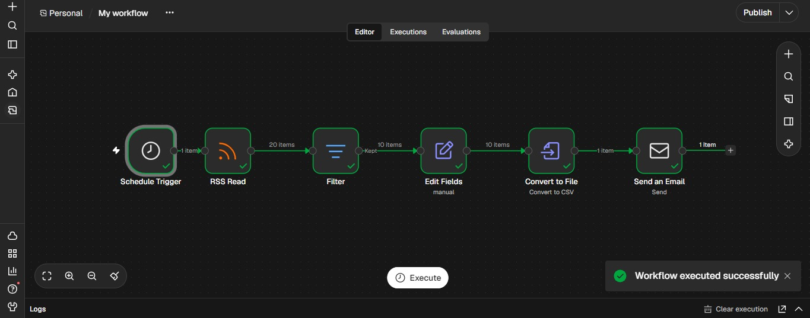
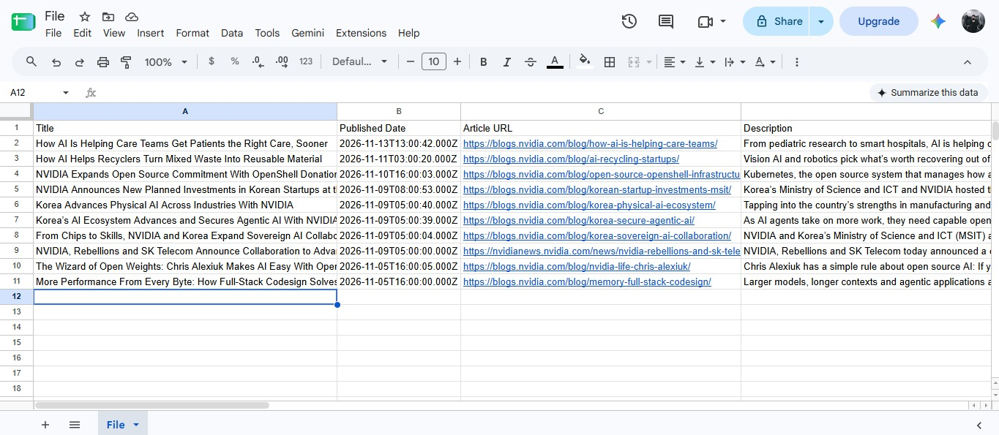
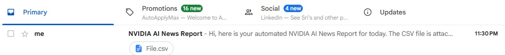
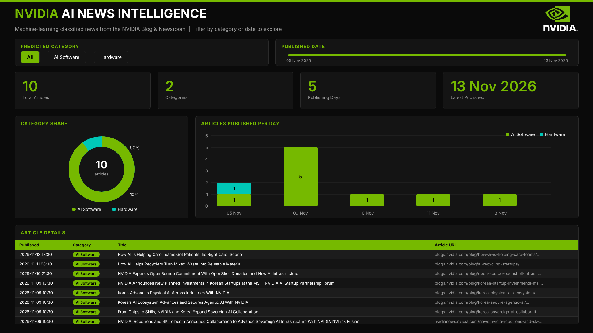

# NVIDIA AI & Data Center News Monitor (ETL Pipeline)

## 📖 Project Overview
This is an independent data engineering portfolio project built using **n8n**. It is a fully automated ETL (Extract, Transform, Load) pipeline that monitors public NVIDIA news releases, filters for relevant AI and computing topics, standardizes the data schema, and automatically emails a CSV report to the user every morning at 8:00 AM.

*Disclaimer: This is an independent learning exercise and is not affiliated with NVIDIA.*

## ⚙️ Architecture

### The ETL Process:
1. **Trigger:** Schedule Trigger (runs daily at 8:30 AM).
2. **Extract:** RSS Read node (pulls from `nvidianews.nvidia.com`).
3. **Filter:** IF/Filter node using Regex (`AI|GPU|Blackwell|data center|computing`) to reduce data noise by 50%.
4. **Transform:** Edit Fields node (maps raw XML to a clean 4-column schema: Title, Published Date, Article URL, Description).
5. **Load:** Convert to File node (generates a CSV).
6. **Deliver:** Send Email (SMTP) node (securely emails the CSV attachment using a Google App Password).

## 📊 Results
### Cleaned Data Output

### Automated Email Delivery

## 📝 Key Learnings & Limitations
* **Schema Mapping:** Learned how to strip away unstructured, messy JSON and enforce a strict schema for downstream consumption.
* **Security:** Configured secure SMTP delivery using Google App Passwords rather than exposing primary account credentials.
* **Limitations:** This pipeline does not feature persistent deduplication. If NVIDIA releases the same article twice, it will be sent twice. A future improvement would be to add a database lookup step (e.g., PostgreSQL or Redis) to track historical GUIDs.

---

## Phase 2: AI/ML Integration & Business Intelligence

After automating the data extraction with n8n, the pipeline was extended to include predictive analytics and visualization. 

### 1. Machine Learning (NLP Classification)
Using **Python** and **Scikit-Learn**, I built a Natural Language Processing (NLP) model to automatically categorize the unstructured news text.
*   **Feature Extraction:** Used `TfidfVectorizer` to convert text into numerical matrices, scoring words based on frequency and rarity.
*   **Model Training:** Trained a **Multinomial Naive Bayes** classifier on a labeled dataset to predict categories such as "AI Software" and "Hardware".
*   **Inference:** Applied the trained model to the n8n pipeline output (`sample_output.csv`) to generate a new dataset (`nvidia_news_ml_output.csv`) containing the AI predictions.

### 2. Power BI Dashboard
To make the ML predictions accessible to stakeholders, I designed an interactive **Power BI dashboard**. 
*   Created custom **DAX measures** to calculate total articles, category percentages, and format date strings.
*   Designed a clean, modern UI with KPI cards, a category distribution donut chart, and a detailed data table.

**Dashboard Preview:**

**Key Learnings:**
*   Bridged the gap between Data Engineering (n8n), Machine Learning (Scikit-Learn), and Business Intelligence (Power BI).
*   Understood the importance of model inference and feature extraction in real-world text classification.
*   Practiced data storytelling by visualizing ML model outputs for non-technical stakeholders.

*   ## 📂 Project Files
*   [**n8n Workflow Export**](nvidia_news_pipeline.json)
*   [**Python ML Classification Script**](02_machine_learning/ml_classification_model.ipynb)
*   [**Power BI Dashboard File**](03_power_bi_dashboard/NVIDIA_AI_News_Classification_Dashboard.pbix)
*   [**ML Output Dataset (CSV)**](02_machine_learning/nvidia_news_ml_output.csv)
